# kHub escrow bot (#3888760)

## Commands you’ll actually use

**On your Mac / IntelliJ terminal**, start in this folder:

```bash
cd "/Users/adityayadav/Desktop/IntelliJ Projects/kolauction/bot"
```

### Everyday commands

| What you need | Command | When / why |
| --- | --- | --- |
| Start the bot | `npm start` | Runs it in the mode set by `BOT_LIVE` in `.env`. The startup log says **LIVE** or **read-only**. |
| Stop the local bot | **Ctrl+C** in its running terminal | Wait for it to exit. Use this before manual corrections or starting the Oracle copy. |
| See what is waiting or needs help | `npm run inspect` | Shows queued deliveries, closet moves, and records needing review. This checks the database; it sends nothing. |
| Is the local bot running or stuck? | `npm run health` | Checks the local monitor. `stale` means its status stopped updating; `unavailable` means no readable status file. This does not inspect deliveries. |
| What was a particular message supposed to send? | `npm run lookup -- D-REPLACE_ME` | Replace the reference with one from your logs. Shows recipient, items/Meat, saved message, state and UUID. Sends nothing. |

**Reading `inspect`:** `pending` means waiting, and `sent` means recorded as delivered.
`closetCounts.pending` means an in-game closet move is waiting—often a fee or donation.
For problems, check **all** of these, not just `attention`:

| Field | What it means |
| --- | --- |
| `pendingDeliveryAttention` | A waiting message failed its preparation check. |
| `heldDeliveryAttention` | It failed **before sending** and was set aside for review. |
| `isolatedDeliveryAttention` | It **may have sent**, but Sent Mail could not confirm it. It will not be resent automatically. |
| `attention` | Uncertain sends; with the updated worker, isolated ones can remain here while other deliveries continue. |
| `closetAttention` | A closet move needs checking. With migration 106 and the updated worker, unrelated funded work continues. |
| `accountAttention` / `mailPolicyAttention` | An account request or an old refund needs attention. |

`inspect` and `lookup` can run in another terminal while the bot is working.
**Run only one bot at a time: Mac OR Oracle.**

### Fix a delivery: the three cases

**Stop every bot before manual corrections.** Replace `D-REPLACE_ME` with the
actual delivery reference, and replace the quoted explanation with what you
actually verified. The commands below deliberately contain placeholders.

**1. It really WAS sent, but the bot could not confirm it.** Check KoL Sent Mail
first, then record success:

```bash
node --env-file-if-exists=.env src/cli.mjs resolve D-REPLACE_ME sent "Verified actual KoL Sent Mail ID REPLACE_ME and the matching recipient and attachments."
```

**This command does not send or check the message.** It marks it delivered in the
database. Do not run it just to dismiss an error or use an example message ID as proof.

**2. It definitely WAS NOT sent.** After confirming the rejection/failure in KoL,
return it to the queue:

```bash
node --env-file-if-exists=.env src/cli.mjs resolve D-REPLACE_ME not-sent "REPLACE_ME with the evidence proving this delivery was not sent."
```

This enables another send when the bot starts again. **Not seeing a sent copy alone
is not proof of failure.** Fix the reason for rejection first; a KoL-banned recipient
still cannot receive a retry. If unsure, leave it isolated for review.

**3. The message failed BEFORE any send attempt.** Fix its preparation error, then
release that hold:

```bash
npm run retry-delivery -- D-REPLACE_ME "REPLACE_ME with the correction you made to message preparation."
```

Use this for `heldDeliveryAttention`, not an uncertain send. It checks preparation
again and releases the hold; the running bot does the actual sending. After your
correction, restart your chosen bot and check `npm run inspect` again.

### Closet problems (`C-` references)

The **closet is the bot’s in-game storage**. `C-` identifies a move into it;
`D-` identifies an outgoing KMail. They use different commands.

| What you need | Command |
| --- | --- |
| What was this closet move? | `node --env-file-if-exists=.env src/cli.mjs lookup-closet C-REPLACE_ME` |
| Inspect the game’s closet pages after repeated failures | `node --env-file-if-exists=.env src/cli.mjs diagnose-closet` |

`lookup-closet` only reads the database. **Stop all bots and log out of KoL before
`diagnose-closet`**: it logs into the bot account, reads pages, and moves nothing.

After checking the actual inventory/closet balances, choose **one** outcome:

```bash
node --env-file-if-exists=.env src/cli.mjs resolve-closet C-REPLACE_ME moved "REPLACE_ME with the before/after balances proving the move happened."
```

```bash
node --env-file-if-exists=.env src/cli.mjs resolve-closet C-REPLACE_ME not-moved "REPLACE_ME with the unchanged balances proving the move did not happen."
```

`moved` records success; `not-moved` permits a retry. Both require the bot stopped.

<details>
<summary><strong>Rare: you manually opened a gift package and its old wrapper move is stuck</strong></summary>

Stop all bots, look up the C-reference, then cancel **only** its never-attempted
wrapper move. This does not cancel auction payouts or resolve uncertain transfers.

```bash
node --env-file-if-exists=.env src/cli.mjs cancel-opened-package C-REPLACE_ME "REPLACE_ME with why this wrapper no longer exists after manual opening."
```

</details>

### Totals, history and maintenance

| What you need | Command | When / why |
| --- | --- | --- |
| Overall donations and auction totals | `npm run stats` | See donation totals, completed sales, commissions and seller proceeds. |
| Donation history | `npm run stats -- donations` | See donors, attachments and original KMail IDs. |
| Sales history | `npm run stats -- sales` | See auction prices, fees and seller payments. |
| Older records | `npm run stats -- sales 2` or `npm run stats -- donations 2` | Replace `2` with the page number; 20 records per page. |
| Refresh item names/images/tradeability now | `npm run sync-catalog` | Normally automatic weekly. Use after new items appear or a failed catalog update. |
| Package the updated bot for Oracle | `npm run bundle` | Creates `exports/khub-bot.tar.gz`, excluding credentials. Does not upload or deploy it. [Deployment steps](DEPLOYMENT.md). |
| Install dependencies after downloading updated code | `npm ci` | Run with the bot stopped before restarting the updated copy. |
| Run local automated checks | `npm test` | Useful after code changes; not needed for everyday operation. |

<details>
<summary><strong>Oracle commands — use these when the bot is running on the server</strong></summary>

From your Mac, using the existing server address/key (update them if replaced):

```bash
ssh -i "/Users/adityayadav/Desktop/IntelliJ Projects/kolauction/bot/keys/ssh-key-2026-10-19.key" ubuntu@157.151.227.17
```

Then run commands **inside Oracle**, from `cd ~/khub-bot`:

| What you need | Command |
| --- | --- |
| Start | `sudo docker compose up -d` |
| Stop | `sudo docker compose stop` |
| Is its container running? | `sudo docker compose ps -a` |
| Watch recent logs | `sudo docker compose logs --tail=50 -f` |
| Inspect deliveries | `sudo docker compose run --rm --no-deps bot node src/cli.mjs inspect` |
| Look up a delivery | `sudo docker compose run --rm --no-deps bot node src/cli.mjs lookup D-REPLACE_ME` |
| Run another CLI command | `sudo docker compose run --rm --no-deps bot node src/cli.mjs COMMAND ARGUMENTS` |
| Apply an edited `.env` | Stop first, then `sudo docker compose up -d --force-recreate` |
| Disconnect from Oracle | `exit` — the running bot stays on the server. |

**Ctrl+C while watching Oracle logs only closes the log viewer. It does NOT stop
the bot.** Use `sudo docker compose stop`. Before running the Mac bot, stop Oracle
and wait for it to exit. [Switch LIVE/read-only mode](#oracle-change-between-read-only-and-live).

</details>

### Update the code running on Oracle

Use this after bot code changes, or if Oracle reports **`bot_claim_delivery without
parameters`**. That error means an older worker is calling the newer database.
Recreating a container alone does not copy your Mac's code or rebuild its image.
Keep the Mac bot stopped throughout.

**1. Oracle terminal:** exit the log viewer with Ctrl+C, then stop the bot:

```bash
cd ~/khub-bot
sudo docker compose stop
```

**2. Separate Mac / IntelliJ terminal:** package and upload the current code:

```bash
cd "/Users/adityayadav/Desktop/IntelliJ Projects/kolauction/bot"
npm run bundle
scp -i keys/ssh-key-2026-10-19.key exports/khub-bot.tar.gz ubuntu@157.151.227.17:~/khub-bot.tar.gz
```

Use the current Oracle IP/key if they have changed.

**3. Oracle terminal:** extract, rebuild, inspect, then start:

```bash
tar -xzf ~/khub-bot.tar.gz -C ~/khub-bot
cd ~/khub-bot
sudo docker compose build
sudo docker compose run --rm --no-deps bot node src/cli.mjs inspect
sudo docker compose up -d --force-recreate
sudo docker compose logs --tail=50 -f
```

Continue to startup only if the build and inspection succeed. The archive excludes
`.env`, so your existing credentials and mode remain in place. Do not copy
`.env.example` over `.env` during an update. Do not rerun already-applied database
migrations just because the server code is old. New feature migrations still need
to be applied once, in order, before starting the matching new worker.

### Start, stop, and switch LIVE/read-only modes — summary

**Use one location at a time: Mac OR Oracle, including read-only mode.**

| Action | Mac: inside the local `bot` folder | Oracle: inside `~/khub-bot` |
| --- | --- | --- |
| Start with the saved settings | `npm start` | `sudo docker compose up -d` |
| Stop before changing mode | **Ctrl+C** in the running bot terminal; wait for exit | `sudo docker compose stop` |
| Edit settings | `nano .env` | `nano .env` |
| Start after changing mode | `npm start` | `sudo docker compose up -d --force-recreate` |
| Check the startup message | Read the running terminal | `sudo docker compose logs --tail=50 -f` |

**To change mode:** stop first, open `.env`, and change the **existing** `BOT_LIVE`
line—do not add a second one:

- `BOT_LIVE=false` → **read-only**: logs into KoL and checks mail; no bids/deposits
  accepted, payouts sent, or mail deleted.
- `BOT_LIVE=true` → **LIVE**: processes real bids, deposits, deliveries and mail cleanup.

In nano: **Ctrl+O → Enter** saves; **Ctrl+X** exits. Start again using the table
above. Confirm the startup log says **read-only** or **LIVE escrow processing**.
Oracle needs `--force-recreate` to pick up the changed `.env`; a plain restart
keeps the old settings.

**Switching between Mac and Oracle:** stop the old copy and wait before starting
the other. After local testing, set the Mac's `BOT_LIVE=false` before returning
to Oracle. On Oracle, **Ctrl+C in the log viewer does not stop the bot**; use the
stop command. Typing `exit` disconnects SSH and leaves its running bot running.

---

## Detailed reference

**Updating for migrations 079–080:** stop the Oracle worker, apply both SQL migrations
in order, install the new worker bundle, then rebuild and restart. The old worker
cannot supply the required inbox scan.

### Minimum bid increases (migration 071)

The first bid must meet the seller's starting price. Later bids use the **current
highest bid**, with the same rules for Direct and Escrow auctions:

| Current bid | Increase | Round increase up to |
| --- | --- | --- |
| Below 1k | 10 Meat | — |
| 1k–under 10k | 100 Meat | — |
| 10k–under 100k | 1k | — |
| 100k–under 1M | 10k | — |
| 1M–under 10M | 3% | 10k |
| 10M–under 100M | 2% | 100k |
| 100M–under 10B | 1% | 500k |
| 10B+ | 0.5% | 500k |

Round the increase up, then add it to the current bid. A 1.75M bid needs 60k more,
so the next minimum is 1.81M. Exact minimum bids are valid; buyouts are exempt.
Rejected funded bids are refunded in full with the required minimum in the reply.
Apply migration 071 and deploy the website; **no bot rebuild or restart is needed**.
Existing accepted bids and deliveries remain unchanged.

### Current escrow fees (migration 069)

The database deducts a **tiered seller commission**, not a flat percentage:

| Portion of final sale price | Fee |
| --- | ---: |
| First 1m Meat | 5% |
| Next 9m (1m–10m) | 4% |
| Next 90m (10m–100m) | 3% |
| Next 900m (100m–1b) | 2% |
| Above 1b | 1% |

Add the portions, then round the total fee down to whole Meat once. A 10m sale
costs **410k**, leaving **9.59m** for the seller. The accepted buyout/final winning
price is used; excess attached Meat is refunded in full. Direct, canceled and
unsold auctions incur no commission. Wrapping costs are separate bot expenses. Commission awaiting player deliveries
is protected from wrapping costs until it reaches the closet queue.

**Apply `supabase/migrations/202610210069_tiered_escrow_fees.sql` with every worker
stopped, then restart.** Website copies begin in the migration queue. This SQL
changes the actual deduction; the existing worker sends the recorded net payout,
without recalculating a flat fee. No JavaScript worker upgrade is required solely
for this fee change. Deploy the updated website for matching wording/estimates.

Open standard-rate escrow listings get the lower schedule. Existing free or
special flat discounts below 5%, finalized fees, queued payments, and frozen
messages stay unchanged. New listings always use `tiered_v1`; changing the legacy
`settings.fee_bps` value does not change that schedule. `npm run inspect` shows
`escrowFeePolicy` with the tiers and rounding rule. Never edit already-finalized
fees or deliveries to apply a new rate retroactively.

### Refunds and deliveries to Hardcore/Ronin players

Before sending assets, the worker freshly checks the recipient profile. A matching
Hardcore/Ronin status selects the gift shop immediately. Otherwise it uses regular
KMail and falls back to a gift only on an explicit recipient-restriction rejection. Items,
quantities, Meat, and the D-reference stay the same. kHub pays the 50-Meat plain
brown wrapper from spare inventory Meat, without using player obligations, pending closet plans, unread
mail attachments, or the configured reserve. Keep some operating Meat available.
This applies to refunds, prizes, item returns, and seller payments with attachments;
ordinary zero-asset notices still use regular KMail.

A timeout or unexplained failure does **not** trigger a gift retry. If the gift
itself cannot be confirmed (including a gift-shop limit/rejection), it is set aside
and reported for review while other funded deliveries continue. Gifts may not
appear in regular Sent Mail: check the recipient's gift packages and delivery
reference before manually reconciling one. Never resend an uncertain gift blindly.
Gift notes use ` | ` between paragraphs/lines so the gift shop does not display
stray `nn` characters. Normal KMail retains its existing formatting.

Previously isolated deliveries are **not** released by this update. Stop every
worker and establish that the old transfer did not happen before using the
`resolve ... not-sent` command below. After a confirmed release, the updated worker
will freshly check the recipient and select a gift for Hardcore/Ronin, or use
regular KMail with the explicit-rejection fallback.
Apply migration 068 before deploying/restarting this worker. It protects pending
closet plans as well as player funds when checking wrapping affordability.

Standalone Node 24+ worker for the KMail escrow workflow. It runs separately from
Vite/Cloudflare and keeps financial state in PostgreSQL through service-only RPCs.
Live login and an account-linking confirmation have been observed. Full auction
and failure scenarios still need controlled live checks before public use.

Everything needed to run, test, and package the bot is inside this folder.
See [DEPLOYMENT.md](DEPLOYMENT.md) for transferring it to an Oracle or other server.
See [MESSAGES.md](MESSAGES.md) for previews of every outgoing KMail and its attachments.

Player messages show a short delivery reference. Operator logs show **both** that
reference and the full delivery UUID before sending, after acknowledgment, and
in delivery failures, along with the recipient/assets and auction UUID on send.
`inspect` and `lookup` expose both IDs for database work and reconciliation.

With migration **064**, `inspect` also checks every pending delivery's message
without claiming or sending it. `pendingDeliveryAttention` lists safe delivery
references and preparation errors (for example, an unrecognized template).
`pendingQueueBlocked: true` means the first pending delivery failed this check;
`blocksQueue` identifies that entry. A later broken message is still listed even
while earlier messages remain sendable. `pendingDeliveryChecks` is the number
checked. Saved message bodies are respected; credentials and message text are
not included in these diagnostics. Existing `attention` remains the separate list
of uncertain sends requiring reconciliation. An empty diagnostics list is not a
full health check for KoL connectivity, inventory, or all other runtime failures.
Apply `supabase/migrations/202610210064_pending_delivery_inspection.sql` in Supabase;
this change requires no worker update.

## Messages set aside for review

Apply migration **065** after 064. If a pending delivery cannot prepare its message,
the database sets it aside and claims the next ready delivery instead. This applies
to notifications **and deliveries carrying items or Meat**. No send was attempted
for this failure. The original delivery stays pending with all assets still owed
and reserved; its auction cannot finish settlement until those assets are delivered.
Other deliveries continue only when the existing inventory/solvency checks pass.

`npm run inspect` lists these separately under `heldDeliveryAttention`, with
`heldDeliveryCount`, delivery references, safe reasons and support-ticket references.
They remain included in pending counts. Each hold creates one **Other** inbox ticket
and one KMail to teres Minor; repeated cycles do not repeatedly notify or retry it.
Closing the ticket does not release or complete the delivery.

After correcting the cause, use the updated local CLI:

```bash
npm run retry-delivery -- D-1080 "Applied the corrected message template."
```

The command checks that message preparation now succeeds, records your correction,
and releases the hold. It does not send anything itself. SQL-only alternative using
the UUID returned by `lookup`:

```sql
select public.bot_retry_held_delivery('DELIVERY-UUID', 'Applied the corrected message template.');
```

Skipping preparation failures works with the existing worker after applying 065;
only the optional `retry-delivery` command needs the updated CLI files. A timeout or
crash **after sending begins** still leaves `sending`/`unknown` for reconciliation.
Migration 066 and its matching worker add automatic Sent Mail checks and isolation
for uncertain sends, described below. Missing messages never authorize a resend.

## Automatic Sent Mail recovery (066)

Apply **066 after 065**, then deploy the updated worker. Restart exactly one copy.
After a timeout, crash or lost database acknowledgment, the worker reads KoL's
**Sent** mailbox before deciding that a delivery needs manual review. It compares
its exact frozen message (allowing HTML presentation/whitespace differences), unique
D-reference or legacy UUID marker, and recipient. Visible attachment metadata must
also match when the sent copy includes it. A single verified copy records the real
KoL message ID and a message hash in reconciliation evidence; it never sends again.

If the check finds no matching copy, multiple/conflicting candidates, an unfamiliar
page, or a network error, that delivery remains **unknown** and is set aside. Other
funded deliveries and intake continue. One **Other** inbox ticket and one KMail to
teres Minor include the D-reference, delivery UUID, recipient, original received
KMail ID when linked, and any candidate sent-message IDs. If no sent-message ID is
known, the alert says so instead of inventing one. A failed alert itself cannot
create an endless chain of new KMail alerts. `inspect` exposes these records under
`isolatedDeliveryAttention`; its existing `attention` still includes all uncertain
records, so older workers remain conservative.

The first unknown record triggers a check immediately. Unresolved records are
rechecked at most once every five minutes per running worker, scanning at most ten
Sent pages per batch. A fresh uncertainty triggers an immediate check. Read failures
and scan limits are not proof of non-delivery. Repeated checks do not resend the
original or repeatedly notify you. Do not delete Sent copies needed for recovery.

Full `bot_liabilities` totals continue to include possibly-sent obligations.
`bot_dispatch_liabilities` separately checks all definitely-unsent obligations so an
already-sent payment does not falsely make every other payout look underfunded.
The unresolved delivery cannot be claimed again and its auction cannot settle.
Closet moves are deferred while any send is uncertain, retaining any disputed assets
still present. Unknown closet moves, unrecorded asset intake and actual shortages
for the remaining obligations still require reconciliation.

Manual outcomes use the existing evidence-based commands:

```bash
npm run lookup -- D-1080
node --env-file-if-exists=.env src/cli.mjs resolve D-1080 sent "Verified KoL Sent Mail ID 7654321 and its recipient."
# Only when there is actual evidence it was not sent:
node --env-file-if-exists=.env src/cli.mjs resolve D-1080 not-sent "Verified that this transfer was not sent using actual KoL evidence."
```

Stop every bot before manual reconciliation or logging into KoL yourself. Resolving
an isolated delivery closes its review record; a verified later mailbox match also
closes the associated system ticket. Closing the ticket alone never changes the
financial ledger. Server-only mailbox-check RPCs can read frozen credential replies
for matching, but those bodies and fetch errors are never logged or copied into
operator alerts.

## Start, stop, and switch live/read-only modes

`npm start` now runs a health monitor plus **one** KoL-connected worker. The
monitor restarts a crashed or stalled worker and waits for it to exit before
starting its replacement. Ctrl+C stops both; it does not trigger another restart.
After updating an older copy, stop it completely before running the new command.

In another terminal, `npm run health` reads local status without logging into KoL
or contacting Supabase. It shows the last successful cycle, current state and
restart count. `blocked` means ledger reconciliation is required; restarting
does not retry or clear an uncertain transfer. `stale` means the monitor's health
file stopped updating. See [health monitor details](OPERATIONS.md#automatic-recovery-and-health).

**Only one copy may run at a time, including read-only mode.** Both modes log into
KoL; simultaneous Mac/Oracle logins have been observed replacing each other's
sessions and causing repeated login messages. The Mac and Oracle have separate
`.env` files: changing one does not change the other. Local LIVE tests use the
same real database, KMail, Meat, and items when configured with the same account.

### Connect to Oracle from your Mac

In a Mac terminal:

```bash
cd "/Users/adityayadav/Desktop/IntelliJ Projects/kolauction"
ssh -i bot/keys/ssh-key-2026-10-19.key ubuntu@157.151.227.17
```

The IP/key filename above were used on October 19, 2026. If the server is replaced,
check its new public IP and the corresponding private key. Once connected:

```bash
cd ~/khub-bot
```

Commands below labeled **Oracle** run in this Ubuntu terminal, not your Mac terminal.

### Oracle: turn the bot on or off

| Action | Command (inside `~/khub-bot`) |
|---|---|
| Start in the currently configured mode | `sudo docker compose up -d` |
| Stop the bot | `sudo docker compose stop` |
| Check whether its container is running | `sudo docker compose ps -a` |
| Watch logs | `sudo docker compose logs --tail=50 -f` |
| Check receipts and deliveries | `sudo docker compose run --rm --no-deps bot node src/cli.mjs inspect` |
| Look up a short delivery reference | `sudo docker compose run --rm --no-deps bot node src/cli.mjs lookup D-1042` |

**Ctrl+C while watching Docker logs only closes the log viewer; it does not stop
the bot.** Use the stop command to stop processing. Typing `exit` disconnects SSH
but leaves a running container running. Stopping the container does not stop or
delete the Oracle VM.

### Oracle: change between read-only and LIVE

First stop the container and wait for the command to finish:

```bash
sudo docker compose stop
nano .env
```

Change the existing `BOT_LIVE` line (do not add a duplicate):

```dotenv
BOT_LIVE=false
```

Use `false` for read-only, or `true` for real auction processing. In nano, save
with **Ctrl+O**, press **Enter**, then exit with **Ctrl+X**.

Apply the new mode by recreating the container; a plain restart does not reload
the environment file:

```bash
sudo docker compose up -d --force-recreate
sudo docker compose logs --tail=50 -f
```

Check the latest startup message says `read-only` or `LIVE escrow processing`,
matching your choice. Read-only still logs into KoL and checks mail, but does not
accept bids/deposits, delete mail, or send payouts.

After checking the logs, you can press Ctrl+C, then type exit to disconnect. The bot will keep running on Oracle.

### Test on your Mac while Oracle is stopped

1. In the Oracle terminal, stop the bot and wait until the command finishes:

   ```bash
   cd ~/khub-bot
   sudo docker compose stop
   sudo docker compose ps -a
   ```

   Confirm the container is stopped (`Exited`). Do not leave an Oracle read-only
   copy running while starting the Mac copy.
2. Open a **second terminal on your Mac**, leaving Oracle's terminal separate:

   ```bash
   cd "/Users/adityayadav/Desktop/IntelliJ Projects/kolauction/bot"
   nano .env
   ```

3. Set the Mac's existing `BOT_LIVE` line to `true`. Save with **Ctrl+O → Enter →
   Ctrl+X**, then run:

   ```bash
   npm start
   ```

4. Test your changes. **Ctrl+C in this local `npm start` terminal requests bot
   shutdown. Wait until it exits before starting Oracle again.** For read-only
   local testing, use `BOT_LIVE=false` instead; Oracle must still remain stopped.
5. After the local bot exits, set the Mac's `.env` back to `BOT_LIVE=false` to
   avoid accidentally starting a second live copy later.
6. In the Oracle terminal, follow the mode-change steps with `BOT_LIVE=true`
   and confirm the new LIVE startup message. That resumes the code already
   deployed there; upload/rebuild separately to deploy your local code changes.

Leaving a read-only bot running does not guarantee Oracle will retain an idle
Always Free VM. Keep code, credentials, and database backups separately.

## Workflow

```mermaid
stateDiagram-v2
    [*] --> AwaitingDeposit: Seller saves listing
    AwaitingDeposit --> Active: Exact items arrive by KMail
    Active --> Active: Funded higher bid; refund previous bidder
    Active --> Sending: Deadline or funded instant purchase
    Active --> Returning: No bids or permitted cancellation
    Sending --> Completed: Item and seller-payment sends acknowledged
    Returning --> Closed: Return sends acknowledged
```



The website initially creates a private `pending_escrow` listing. Only its seller
can read it before activation. The seller's linked numeric KoL identity and the
catalog item ID are authoritative; typed names/body amounts cannot fund auctions.
The default timer starts on acceptance of the exact item deposit. The first bid
must meet the starting price; further bids must exceed the accepted high bid.
Each new KMail attaches the **full** bid, including when the same player raises.
The former high bid returns in full. Bid eligibility uses KoL's recorded KMail timestamp.

A bid reaching/exceeding the instant price closes the auction at the instant
price and refunds any excess. Settlement waits for the closing inbox check. `BUY` can also be used explicitly.
With no winning bid, the lot returns to its seller. A seller may cancel before a
bid; a deposited lot is returned by the same durable delivery queue. Bids cannot
be withdrawn. Prior in-memory/development auctions remain **legacy** and are not
assumed funded: finish or retire those separately before launch.

Current defaults after migration `069`: deduct the tiered **5% / 4% / 3% / 2% / 1%**
seller commission described above; start duration when the item deposit is accepted.
These supersede the historical flat 7.5% default from migration `013` for new auctions.
The website’s Info page explains the KMail workflow and fee tiers.

## Exact KMail commands

After migration `019`, normal KMail with **no attachments** can also contain:

| Message | What happens |
| --- | --- |
| `REGISTER` | Create one account using the sender's verified KoL name and player ID. Custom usernames are not accepted. |
| `CREDENTIALS` | Send the linked account's username/login identifier and a new generated password. |

`FORGOT LOGIN` is an alias for `CREDENTIALS`. Registration automatically verifies
and links the real KMail sender's player ID. Taken names, existing linked accounts
and bans are checked in the database. A request cannot choose another player's
account to recover. Registration/recovery with attached assets is rejected/refunded.
Wait five minutes between successful account requests; repeated reads of the same
KMail never reset the password again. After login, use Your Account → Change password.

**Rollout:** stop every worker, apply queued website migration `019` after `018`,
then deploy/restart this updated bot and website. The bot's standalone copy stays
in `supabase/migrations/202610190019_kmail_accounts.sql`; website copies start in
`supabase/migrations/queue/`. Public email signup is disabled by the database trigger.
New Auth users are provisioned with the server-only Admin API and a generated
internal address; this flow never requires SMTP. Existing email accounts keep their
login/history and can use KMail recovery once linked. Unlinked legacy accounts need
manual support if their owner cannot log in to link them.

Pending account requests survive restarts in Supabase. Auth operations use a fixed
user ID and request stamp to recover a lost response without making another account
or changing the password again. Credential replies use the same tracked D-reference
and uncertain-send reconciliation as other messages. `inspect` includes safe
`accountAttention` summaries; `inspect` and delivery lookup omit credential bodies.
Generated secrets are cleared from job records after queuing, and from delivery
bodies after confirmed sending. Keep KoL credential replies/sent copies private.

Account processing failures are isolated from auction finalization and deliveries.
An unsuccessful registration/recovery request remains pending for retry, and its
source KMail is excluded from cleanup for that cycle. Each request is attempted
at most once per cycle, even if it appears in both the pending queue and inbox;
Migration 067 saves retry timing in the database: one initial attempt plus two
retries on subsequent cycles, then at least five minutes between further attempts.
Restarting the bot does not reset this schedule. A cycle handles at most two
account requests and starts no further account request after 20 seconds of account
work, keeping a signup backlog from taking over auction processing. An already
running request may finish after that budget. Auth and account-only
database calls have a 20-second timeout, while financial RPC/send behavior stays
unchanged. A failed pending-account queue read also defers to the next cycle.
If an account KMail has attachments and preparation has not confirmed their durable
receipt, processing still stops to protect those assets. Solvency, uncertain-send
and uncertain-closet-transfer gates remain enforced. Apply migration 067 and
deploy/restart the matching bot; no website deployment is needed.

Migration 059 adds once-only account-failure notices. A failed pending registration
or recovery queues a friendly player KMail explaining that the saved request will
retry automatically, plus an Other admin inbox message and KMail to teres Minor
(#3552305). Repeated failures, concurrent calls and restarts reuse the same alert;
they never resend it. A lost completion acknowledgment does not queue a failure
after the job has completed. Notices contain no passwords, internal login addresses
or raw Auth errors. Notification failures defer and retry without blocking safe
auction processing. Apply 059 before deploying this notification update.

Send to **kHub (#3888760)**. Use normal KMail, without gift wrapping or valentines.

| Message body | Attachments |
|---|---|
| `VERIFY <code from Your Account>` | Nothing |
| `LIST 1001` | Exact listed item and quantity; no Meat or extras |
| `BID 1001` (or just `1001`) | Full bid in Meat; no items |
| `BUY 1001` | Full instant price in Meat; no items |
| `DONATE` | Meat and/or items to donate; without attachments, returns donation instructions |

Replace `1001` with the auction number copied from the website. `#1001` also
works. Existing full-UUID commands remain valid. Auction numbers identify listings;
`D-` references identify outgoing deliveries and cannot be used to bid.

Every seller/buyer links their website account by sending a random, single-use,
20-minute verification challenge from the KoL account they own. A KoL player ID
can link to only one website account. The bot checks its own session is player
#3888760, outside Hardcore/Ronin. Never use this account for adventuring/manual
asset transfers while it holds escrow.

Recognized but rejected normal commands (wrong sender, unlinked account, late or
underpriced bids, extra items, and closed auctions) are recorded and refunded.
Their source mail stays in the inbox for manual review. Unrecognized normal text with assets is refunded with an invalid-command reply.
Unfunded unrelated normal text, system/self mail, Valentine mail, unsupported types,
and individually malformed messages are left untouched; valid commands continue processing. Whole-API/database failures still stop processing safely.

With migration 097, gift packages with exact auction commands in the outside note
are opened, correlated with the updated original KMail, and validated as deposits
or bids. Other packages are donations: their contents enter the audited closet
queue and receive one thank-you. Legacy donation receipts remain donations.
Normal KMail with exactly DONATE also qualifies; empty DONATE returns instructions.
Blank/invalid normal mail carrying assets is refunded with an invalid-command reply;
empty unknown mail without assets is ignored. Normal donations require DONATE.
Accepted normal source mail is deleted only after its immediate replies/refunds are
confirmed sent. Uncertain deliveries retain their source mail and receive a separate
tracked, asset-free support notice; an uncertain support notice is never retried blindly.
KoL saves outgoing messages in Sent, while incoming problem mail stays in Inbox.

See [operations and recovery](OPERATIONS.md) for downtime behavior, manual review,
asset checks, backups, and work still required. Apply migration `012` after `011`
and restart the updated worker before expecting this behavior.

## Installation and first start

1. Install **Node.js 24 LTS or later**. The website's older Node version can remain
   separate; `kol.js` uses the built-in SQLite module for its session flag cache.
2. For a new database, apply the migrations through KMail account creation (`019`) as explained in
   [supabase/README.md](supabase/README.md). An already configured database needs
   no migration reruns when moving hosts. Back up your database before upgrades.
3. In a terminal inside this bot folder:

   ```bash
   npm ci
   cp .env.example .env
   ```

   Only copy `.env.example` if you do not already have a configured `.env`.

4. Edit `.env` locally: set `SUPABASE_SERVICE_ROLE_KEY` (or your project's
   server secret key), `KOL_PASSWORD`, and confirm the project URL. Keep
   `KOL_USERNAME=kHub`. These are server credentials, **never VITE_ settings**.
   `.env` is gitignored; do not send passwords in chat or commit them.
5. With migration 052, the live worker initializes the bundled catalog and refreshes
   it weekly. To force a current upstream refresh and inspect the connection:

   ```bash
   npm run sync-catalog
   npm run inspect
   ```

6. Deploy/rebuild the website with the new code and migration. New listings require
   linked accounts and exact item IDs; the old unfunded browser bid/purchase RPCs
   refuse escrow auctions. Website forms now provide KMail instructions instead.
7. Give the bot at least `BOT_MEAT_RESERVE` operating Meat (default 1,000), using
   normal KMail with the exact message `DONATE`. With migration `009` and this
   worker, it records the donation, retains the Meat, and sends a thank-you.
8. Run read-only first:

   ```bash
   npm start
   ```

   `BOT_LIVE=false` logs in and previews supported inbox messages but does not
   ingest receipts, activate listings, delete mail, or send anything. It does not
   simulate a completed auction. Use local tests for a full simulated loop.
9. After checking the account and doing the deployment checks below, set
   `BOT_LIVE=true` and run `npm start` to enable real escrow intake and delivery.
   **Ctrl+C** requests shutdown after the current operation/cycle; do not force
   kill during a transfer unless necessary.

The bot must stay running on your Mac or an always-on server/container. A sleeping
Mac pauses it; Cloudflare's static website deployment does not run this worker.
Use one monitored worker. An external restart policy is fine; unresolved sends remain
blocked across restarts. Polling defaults to 15 seconds, minimum 10 seconds, with
one-second pacing between mail operations. All accepted state/obligations live
in Supabase, not in the worker's local cache.

## Settings

SQL Editor (deposit timing affects **future listings**):

```sql
-- Start the timer only after the listed items are deposited:
update khub_bot.settings set start_on_deposit=true where id;
-- Migration 069 fixes new escrow listings to tiered_v1.
-- fee_bps is legacy metadata, NOT a control for the tiered commission.
-- To keep the original listing deadline instead, use start_on_deposit=false.
```

Fee calculation rounds down to whole Meat; seller proceeds = winning price minus
fee. Zero proceeds do not create a zero-amount payment. Large quantities/payments
are split into deterministic sends of at most one billion units each, one item
kind per KMail. Every part has its own receipt and retry protection.

## Look up requests on your local Mac

Open another terminal and enter the bot folder:

```bash
cd "/Users/adityayadav/Desktop/IntelliJ Projects/kolauction/bot"
```

Check the overall status, look up a delivery (`D-`), or look up a closet transfer
(`C-`):

```bash
npm run inspect
npm run lookup -- D-1033
node --env-file=.env src/cli.mjs lookup-closet C-1001
```

Replace the example references with the ones from your logs or inspection output.
Full UUIDs also work. These commands only read Supabase, so you can run them while
the bot is running; they do not log into KoL or send anything. An empty `attention`
list only means no uncertain sends are listed there. Also check
`pendingDeliveryAttention`, `heldDeliveryAttention`, `isolatedDeliveryAttention`,
`closetAttention`, `accountAttention` and `mailPolicyAttention`.

Stop all bot instances before logging into KoL manually or resolving an uncertain
delivery/closet transfer. Looking up a record does not resolve it or retry it.

If a closet request keeps failing, stop every bot instance and log out of KoL,
then run this read-only game diagnostic from the `bot` folder:

```bash
node --env-file=.env src/cli.mjs diagnose-closet
```

It logs into KoL and reads the closet/inventory pages without submitting any
transfer. Output includes response statuses, redirect page names and form field
names; session tokens and raw page HTML are excluded. Share the output when
troubleshooting. This does not resolve or retry any C-reference.

## Donation, commission and auction totals

Apply `supabase/migrations/202610190017_financial_reports.sql` in Supabase SQL Editor
(normally after `016`). This report also works on earlier escrow databases with
short auction numbers; it does not require migration `015` or its mail-policy table.
This particular report migration is safe to rerun. From the local `bot` folder, run:

```bash
# Lifetime totals: donated Meat/items, gift packages, commission and trade value
npm run stats

# Donation history: date, donor, KMail ID and recorded attachments
npm run stats -- donations

# Completed sales: auction number, final price, commission and seller proceeds
npm run stats -- sales

# Histories show 20 records per page; request older records like this
npm run stats -- donations 2
npm run stats -- sales 2
```

These commands only read Supabase. They work while the bot is running, do not log
into KoL, and create no report files. For Oracle's Docker copy after deploying this
code, use `sudo docker compose run --rm --no-deps bot node src/cli.mjs stats`
(append `donations`, `sales`, or a page number as above).

Totals use the existing retained ledger, including earlier recorded history:

- **Donations:** accepted explicit DONATE Meat and item quantities, plus a count
  of gift-package messages. Invalid/blank normal mail, correction refunds and
  empty DONATE help requests are excluded. Item names come from the catalog.
- **Commission earned:** the actual recorded fees from fully completed escrow
  sales. Older fee rates are preserved; it does not assume every sale charged 7.5%.
- **Auction value traded:** the final winning price of each completed escrow sale,
  counted once, including commission. This excludes active/settling auctions,
  unsold/cancelled lots, refunds and older manually settled website-only trades.
  Split payments and repeated inbox reads do not multiply the totals.

These are historical amounts, not current inventory/closet balances. Withdrawing
completed closet deposits does not reduce the totals. Gift contents are not
inspected; item donations and packages are not assigned estimated Meat values.
Unrecorded manual gifts cannot be reconstructed from the current account balance.
Keep the ledger and database backups to preserve the history. Reports are restricted
to the server-only service credential; donors and income are not publicly exposed.

## Restart and uncertain sends

There is no distributed transaction or idempotency key for a KoL asset send.
This code **does not claim exactly-once external delivery** after a lost response.
Instead:

- Intake mail ID, normalized/raw receipt, accepted bid/escrow changes, and refund
  obligations are committed in one DB transaction. Duplicate inbox mail is safe.
- Delete accepted normal source KMail only after that transaction commits and all of its immediate deliveries are acknowledged as sent; rejected and unrelated mail stays in the inbox. A failed deletion can
  be retried; it cannot repeat the escrow operation.
- Claim a delivery durably as `sending` before contacting KoL. Sends use one raw
  session request with automatic retries/redirect-following disabled, save a sent
  copy, and include a unique short footer such as `Reference: D-1042` in the body.
  Older sends retain their `[kHub delivery <delivery UUID>]` markers. The database
  maps short references to full UUIDs; `npm run lookup -- D-1042` shows the record.
- Mark `sent` only on the expected positive acknowledgment. A timeout, unexpected
  response, rejected transfer, failed DB acknowledgment, or crash leaves
  `sending`/`unknown`. With 066 and its worker, automatic Sent Mail recovery either
  confirms it or sets it aside with an administrator alert while other funded
  deliveries continue. Before 066, further transfers stop for manual reconciliation.
- Completed/returned status is set only once all of that auction's queued sends
  are acknowledged. No participant can mark a new escrow sale completed manually.
- Check inventory and Meat against active holds and definitely-unsent delivery
  obligations before sends; possibly-sent obligations stay separately recorded
  while isolated. A deficit for the remaining obligations stops processing. Exact donations and earned
  fees are moved to the closet; the bot never spends them or withdraws them automatically.

### Resolution examples: deliveries and closet transfers

Stop **all** local and Oracle bot instances before resolving anything. Run these
commands from the `bot` folder. Replace the example reference and quoted evidence
with the actual record and what you verified; full UUIDs also work.

There are two types of resolution, each with two possible outcomes:

| Reference | Command | Confirmed successful | Confirmed unsuccessful |
| --- | --- | --- | --- |
| `D-1042`: outgoing KMail, including refunds, items, payments and notices | `resolve` | `sent` | `not-sent` |
| `C-1001`: donation or commission moved into the closet | `resolve-closet` | `moved` | `not-moved` |

First inspect the records:

```bash
npm run inspect
npm run lookup -- D-1042
node --env-file=.env src/cli.mjs lookup-closet C-1001
```

**Delivery confirmed sent:** verify the unique reference, recipient and exact
attachments in KoL's Sent mail. Record that it was sent, without sending it again:

```bash
node --env-file=.env src/cli.mjs resolve D-1042 sent "Verified sent-copy marker and exact attachments in KoL"
```

**Delivery confirmed not sent:** only use this with evidence that the request was
rejected and nothing was transferred. This requeues the same delivery for retry:

```bash
node --env-file=.env src/cli.mjs resolve D-1042 not-sent "Verified the request was rejected and assets never left"
```

**Closet transfer confirmed moved:** compare the recorded `before_state` with the
actual inventory and closet balances. For example, a one-item transfer starting
with 2 in inventory and 0 in the closet should leave 1 in each, assuming no other
item activity. Record the completed move without repeating it:

```bash
node --env-file=.env src/cli.mjs resolve-closet C-1001 moved "Verified 5-ball: inventory decreased from 2 to 1 and closet increased from 0 to 1; no intervening item activity"
```

**Closet transfer confirmed not moved:** only use this when the balances and other
evidence establish that nothing moved. This normally requeues the same transfer;
migration `015` cancels an earlier misclassified donation plan instead:

```bash
node --env-file=.env src/cli.mjs resolve-closet C-1001 not-moved "Verified 5-ball balances unchanged: inventory 2, closet 0; no intervening item activity"
```

Choose **one outcome per uncertain record**, supported by actual evidence. The
5-ball counts above are examples, not a substitute for checking the account.
Meat transfers use the same closet commands, with Meat balances as evidence.
Never resolve `not-sent` merely because a recipient has not responded, or
`not-moved` merely to unblock the bot. If evidence is inconclusive, keep it blocked.
Resolutions are stored in an append-only audit record; do not edit ledger rows
manually to bypass this process.

After resolving, log out of KoL before restarting **one** bot instance. For local
testing, run `npm start`. Check `npm run inspect` again for any remaining problems.

### Cancel a wrapper plan after manually opening a gift package

Opening a gift package consumes its wrapper. If a pending closet plan still expects
that wrapper, stop all bots, apply `supabase/migrations/202610190016_cancel_opened_package.sql`
once after `015`, then use:

```bash
node --env-file=.env src/cli.mjs lookup-closet C-1002
node --env-file=.env src/cli.mjs cancel-opened-package C-1002 "Owner opened the gift package manually; its plain brown wrapper was consumed"
npm start
```

Replace the reference and reason with the actual record and evidence. This only
cancels never-attempted, pending `gift_package` wrapper plans. It records an audit
entry and moves no assets. It cannot cancel donation/commission obligations or
resolve an uncertain transfer. Opened contents are not automatically swept into the
closet; move those owner assets manually with all bots stopped if desired. Keep
future gifts under the durable intake workflow described in migration 097 below.

## Verification

```bash
# From this folder (Node 24+)
npm test
# Optional: PostgreSQL tools on PATH
python3 tests/database_test.py
```

Local tests cover parsing, identity checks, no-retry send settings, failed receipt
persistence, uncertain sends, restart blocking, solvency, and read-only behavior.
The PostgreSQL suite exercises the actual migrations/RLS/RPCs, verifies challenge
linking, activation, refunds, instant-price excess, cancellation/unsold returns,
service-only permissions, pending-listing privacy, and persisted outcomes.

Before public launch, use your own controlled accounts to verify real KoL login,
raw inbox parsing, exact successful-send acknowledgment, numeric recipient IDs,
blocked recipients/restricted items, item IDs, split delivery parts, all five loop
steps, restarts after successful sends, delayed mail, rollover, and KMail account recovery.
A false or unrecognized send acknowledgment deliberately pauses rather than
silently retrying. Live credential/transport validation cannot be proven by
fixture tests. Receipt data is private; retain backups and monitor `npm run inspect`.

## References inspected

Implementation is original; these projects informed the KoL integration:

- [ChatRelay](https://github.com/libraryaddict/ChatRelay), commit
  `211f047f2217e2789aa61ef5deed357a79939500`: API mailbox parsing and saved-copy mail sends.
- [oaf](https://github.com/loathers/oaf), commit
  `a0b732802130db7e67e4d2847ca16122cbe94a08`: maintained `kol.js` client integration.
- [kol.js](https://github.com/loathers/kol.js), pinned npm version `0.15.4`:
  session handling, normal-mail parsing, and send retry behavior.
- [KoLmafia SendMailRequest](https://github.com/kolmafia/kolmafia/blob/main/src/main/java/net/sourceforge/kolmafia/request/SendMailRequest.java):
  send response handling. The stricter positive acknowledgment here needs checking
  against an actual controlled kHub send before production.


Optional container (build from inside this bot folder):

```bash
docker build -t khub-bot .
docker run --rm --env-file .env khub-bot
```

The image copies only bot source/dependency manifests and the item catalog; it
never copies `.env`. Docker Compose and migration steps are documented in
[DEPLOYMENT.md](DEPLOYMENT.md). Create a credential-free transfer archive with
`npm run bundle`. The container build has not been run as part of local tests.

For the styled donation thank-you and error contact, stop the bot, apply
`supabase/migrations/202610190010_donation_message_style.sql` once after `009`,
then deploy the updated bot. The footer is saved with each newly claimed message;
previously claimed retries retain their original wording. No refund or auction rules change.

For the revised donation wording (without the decorative heading), apply
`supabase/migrations/202610190011_donation_message_wording.sql` once after `010`.
This is a database template change; the worker updated for `010` needs no rebuild.
Newly claimed donation messages use the new text; existing retries keep their saved text.

For the **historical commission/donation closet setup**, apply migration `013` after `012`
with all bots stopped, then restart this worker. See
[closet handling and reconciliation](OPERATIONS.md#donation-and-commission-closet).
Explicit DONATE donations and earned fees are tracked exactly; gift
packages stayed unopened before migration 097. Existing listing fees and old untracked income are not
retroactively changed. The optional extra Meat buffer now defaults to 0; escrow
obligations remain fully protected without additional owner funding.

For auction-number-first message headings, the revised outbid notice and the full
seller payment breakdown, apply `supabase/migrations/202610190014_auction_message_layout.sql` once
after `013`. This only changes database templates: an already updated `013` worker
needs no rebuild/restart. Previously claimed messages keep their saved wording.

## Rollover and optional extra Meat buffer

`BOT_MEAT_RESERVE=0` is the default: keep exactly the Meat/items owed to players,
without requiring an additional 1,000 Meat. Nonzero values are an optional extra
owner-funded buffer. Your local `.env` has been updated; existing server `.env`
files must be updated separately if they still specify 1000.

No nightly server reboot is needed. New outgoing asset transfers, support notices,
and closet moves pause during the two minutes before KoL's reported rollover time.
The client waits through recognized maintenance, reconnects as needed, and resumes;
startup during rollover waits too. Unknown sends/moves remain blocked for evidence,
even after maintenance ends. See [rollover handling](OPERATIONS.md#rollover-wait-and-resume-without-a-scheduled-reboot).

For corrected invalid/blank-mail refunds and safe handling of earlier implicit
donations, apply migration `015` after `014` and restart this updated worker.
The closet item request now uses GET as required by the game adapter, with safe
balance diagnostics on failure. Existing uncertain C-references still require
actual inventory/closet evidence. See [invalid mail and closet recovery](OPERATIONS.md#invalid-normal-mail-and-the-closet-request-correction-015).

Item deposits now target `fillcloset.php` directly instead of `inventory.php`.
Closet requests return redirect responses without following them, then verify
the actual inventory/closet balance change. A redirect alone never counts as
success. Failed requests include response status, a safe redirect pathname when
available, and safe error names/network codes in diagnostics;
raw URLs and session tokens are not logged. Restart the local worker to load this
change (rebuild the container for Oracle); no additional SQL is needed. An existing
unknown C-reference still needs evidence-based reconciliation before processing resumes.

Login now loads `main.php` after API authentication and again after a reconnect.
KoL requires that page to finish initializing ordinary game-page access. A live
read-only check confirmed closet, fill-closet and inventory pages changed from
HTTP 302 redirects to HTTP 200 after this correction. Tests also cover initialization
after relogin. Restart the worker to load the change; no SQL change is required.

To remove decorative dash underlines from auction KMail, apply
`supabase/migrations/202610190018_plain_auction_headings.sql` after `017`.
Auction numbers still appear above the item names. This is a database template
change: no worker rebuild or restart is needed, and this migration is safe to rerun.
Already sent messages and previously claimed retries keep their saved wording.

### Registration stops with an Auth account-creation error

If registration using `019` stops with `Auth account creation was not confirmed`,
apply `202610190021_auth_creation_order.sql` with all bots stopped. The website
copy starts in `supabase/migrations/queue/`; the standalone copy is in this bot's
`supabase/migrations/`. Apply it once after `019`; `020` is independent.

Supabase Admin API inserts the Auth row before setting its `app_metadata`. The
original `019` trigger checked that metadata too early. `021` instead validates
the exact user ID/internal address against the private pending registration job
at INSERT; finalization still requires the server-controlled request stamp before
queuing credentials. No profile is created from client-supplied identity claims.

After applying `021`, run `npm start` again from this folder. The original pending
request resumes with the same account ID and password. Do not reset the database,
delete the pending request or send another REGISTER to repair this failure.
The updated bot prints only safe HTTP status/error codes for Auth failures;
passwords, raw API messages and credentials are never included in those errors.


### Temporary login password is difficult to copy

KMail inserted spaces even into the earlier hyphen-separated password format.
New temporary passwords are 16 characters: a fixed mixed-class prefix plus 12
uniformly random letters/digits (about 71 random bits). They contain no spaces,
hyphens, underscores or HTML-sensitive characters.

With all bots stopped, apply `202610190022_short_temporary_passwords.sql` after
`021`, then restart the updated bot. The website copy starts in the migrations
`queue/`; the standalone bot copy is in `supabase/migrations/`. This updates the
old database minimum of 24 for generated temporary passwords to 16. The website's
12-character minimum for user-chosen passwords is unchanged. Existing passwords,
pending jobs and saved deliveries remain unchanged.

For an already issued password, remove only spaces inserted by KMail: the old
bot-generated passwords never contained spaces. Do not remove actual hyphens.
For a fresh 16-character password, send `CREDENTIALS` from the linked KoL player
with no attachments after restarting. Wait at least five minutes since the last
successful account request and use the newest reply. Change the password from
My Account after logging in. The bot never automatically replaces a pending job's
saved password, since that could invalidate a reply that has already been sent.

## Login usernames (`027`)

Apply `202610200027_prefixed_login_names.sql` after `026`, then deploy the matching
website. New credential KMail shows one `kHub Username: KH_<KoL name>` line.
Existing KMail accounts use the same password with the prefixed login name.
Public profile/seller names stay unchanged; no account names, passwords, pending
jobs or already queued/uncertain messages are rewritten. Old saved credential
messages therefore still show the old name: add `KH_` when signing in.
The prefix is a naming distinction, not an extra authentication factor.
Legacy email accounts retain email login; their recovery mail labels it separately.
The current worker needs no code update or additional instance for this migration.

### Buy auctions — migration 085

Apply `202610220085_buy_auctions.sql` **after 084**, with the Oracle worker stopped.
Install the matching tested worker bundle before restarting Oracle, then deploy the
website. Applying SQL, uploading the worker, and deploying the website are separate
steps. Existing Sell auctions and their recorded financial terms are unchanged.

Buy auctions are escrow-backed purchase orders. The buyer sends `FUND <auction
number>` with the complete deposit (purchase value plus fee reserve) within 24 hours.
Funding starts the full selected duration. Orders are limited to 20 billion Meat
including fees, matching the current normalized KMail funding limit. Buy auctions
use preset durations; the Sell form retains its custom ending-time option.

Other linked players send `FILL <auction number>` with the requested item. Each
receipt atomically accepts at most the remaining quantity, records the full seller
payment and separate buyer commission, and returns excess items. Wrong items,
restricted accounts, closed orders, and invalid deposits are refunded/returned.
Sellers never pay the buyer's fee. Receipt IDs prevent duplicate allocation.

Commission uses the existing marginal tiers **per item**, multiplies the unrounded
fee by each fulfillment's quantity, then rounds down. Funding reserves round up;
any unused purchase balance and fee reserve are refunded at close. Fees and completed
purchases are final even if the buyer cancels the remaining quantity.

Immediate delivery queues each purchased batch. Finished delivery keeps acquired
inventory separate from outstanding requested quantity, then queues it on full fill,
cancellation, or expiration. Orders remain `settling` until all ledger deliveries
are confirmed, using the existing Sent Mail recovery and manual reconciliation.
Uncertain sends must never be blindly resent. Buy-order fees use the existing
closet income ledger, and buyer balances/held items are included in solvency checks.

Private fulfillment records retain seller IDs, receipt IDs, quantities, prices,
fees, and delivery references. Participants can use the existing auction support
thread; administrators can inspect the individual delivery references. The UI
shows the latest 100 fills; the full ledger remains in PostgreSQL.

Offline verification (from the website root):

```bash
node --test tests/*.test.mjs
python3 tests/buy_orders_database_test.py
python3 tests/database_test.py
```

The matching standalone copy is `bot/tests/buy_orders_database_test.py`. Bot tests
require Node 24 or newer. `npm run inspect` includes buy escrow totals, and
`npm run stats -- buy-orders 1` shows fulfillment history. These reports do not send
anything. No live KMail or hosted database is used by the test suites.

### Reservations and buyer gift expenses — migration 086

Apply **085, then 086**, with the Oracle worker stopped; upload the matching latest
bundle before restarting, then deploy the website. This section supersedes the
reservation-free FILL instructions above. Sell-auction gifts still use kHub's
operating funds.

Sellers must reserve a quantity on the website before sending any items. Copy the
entire generated `FILL <auction number> <reservation UUID>` command and attach
exactly that quantity. Reservations last up to 10 minutes (or the auction's earlier
ending time). KoL's actual received timestamp controls timeliness, so a timely
deposit can still be accepted after delayed processing. A complete post-deadline
inbox scan, with the existing 60-second mail grace, releases unused reservations.
FILL payloads are durably staged alongside escrow bids for restart recovery.

Available quantity excludes both purchases and active reservations, and their
purchase/commission commitments are protected from gift expenses. Each account can
hold at most 3 active reservations and create at most 12 per hour. Retrying the
same reservation does not create another or extend its deadline. There are no
automatic fines, bans or ratings for expiration. Reservation history is retained
for administrator review of deliberate repeated blocking.

The buyer still deposits the full purchase value plus the commission reserve:
1,000 × 200 Meat = 200,000 purchase funds + 10,000 reserve = **210,000 Meat**.
No extra automatic gift allowance is added to that example. Pending purchased-item
deliveries hold up to 50 Meat per package from uncommitted escrow until the fresh
recipient check decides whether a gift is required. This is a temporary hold,
not a commission or a purchase. Ordinary KMail releases it without a gift charge.

Hardcore/Ronin item gifts debit 50 Meat per package through an idempotent delivery
ledger, separately from commissions. Only unreserved purchasing power can shrink;
the original request, purchased quantity, reservations, and expense-driven quantity
reductions remain separate. Purchased items never count as reductions, and reduced
quantities never count as purchases. Top-ups or proven no-send resolutions may
restore purchasing power before final settlement.

If all remaining Meat is already committed, a required gift safely waits for a
buyer top-up instead of taking funds owed to sellers. The buyer gets instructions
to send additional Meat using `FUND <auction number>`; no items are discarded or
resent. A deferred package does not block unrelated funded deliveries. The per-mail
top-up limit is 20 billion Meat; it does not prevent adding a small shipping top-up
to an already fully funded order at the initial order limit.

Cancellation stops new reservations and honors existing ones until fulfilled or
safely expired. Finished-mode items remain held until closure. Refund planning waits
for purchased-item delivery confirmation so final packaging can be charged before
the unused balance is returned. Unknown sends keep conservative expense records and
use the existing evidence-based reconciliation. A known no-attempt or an operator's
proven not-sent resolution releases the charge; a timeout never justifies a resend.

Additional offline check, from the website root:

```bash
python3 tests/buy_reservations_database_test.py
```

The matching standalone copy is in `bot/tests/`. Admin auction details include the
reservation/gift audit, and inspect/financial summaries include gift expenses.

### Effective fee percentages — migration 087

Apply `202610220087_effective_fee_percentages.sql` after 086, then deploy the website
and matching worker bundle. Fee amounts and settlement behavior are unchanged.
Website estimates and actual fees, buyer fulfillment history, seller KMail payouts,
buyer purchase receipts, and financial reports include the effective percentage:
`Tiered Fee (4.1%): 410,000 Meat` for a 10M purchase/sale. The percentage is the actual
commission divided by purchase/sale value, excluding separate gift expenses.
Estimates and rounded-up reserves are labeled separately. Display uses up to four
decimal places with trailing zeros removed; positive rates below that precision
show `<0.0001%`. Legacy flat fees retain a plain `Fee` label. Already frozen/sent
message bodies are preserved so their recovery references still match.

Offline check from the website root:

```bash
python3 tests/fee_display_database_test.py
```

### Completed bidder names and site announcements — migrations 088–089

Apply `202610220088_completed_bidder_usernames.sql`, then
`202610220089_site_banner.sql`, after 087 and deploy the website. These changes do
not require an Oracle container restart. Completed Direct and Escrow trades reveal
all bid usernames to signed-in, unrestricted users; before completion, concluded
trades reveal only the winner. Guest aliases, private bidder IDs and admin delivery
references retain their existing protections.

The home page’s **Beta · What’s New ↗** link opens the Update Log. From the
administrator inbox, **Manage site banner** lets the admin publish, edit or hide a
plain-text announcement across the site. Dismissals are remembered on that browser;
a changed or re-published message appears again. Active pages refresh it within
30 seconds or when returning to the tab.

Offline check from the website root (also available in the standalone bundle):

```bash
python3 tests/site_updates_database_test.py
```

### Cancel a seller reservation — migration 090

Apply `202610220090_cancel_buy_reservations.sql` after 089, then deploy the website.
No Oracle restart is required. Sellers can use **Cancel reservation** before sending
items to release their quantity immediately. Only the reservation owner can cancel;
completed purchases are never reversed. If the worker has already staged incoming
items, cancellation waits for verification. Items arriving later with a canceled
reservation code are safely returned through the existing refund queue. Cancellation
is audited and idempotent and remains serialized with fulfillment, gift budgets and
buyer-order closure. Canceled reservations still count toward the existing hourly
reservation limit.

Offline check from the website root (also included in the standalone bundle):

```bash
python3 tests/cancel_buy_reservations_database_test.py
```

### Expiration versus cancellation — migration 091

Apply `202610230091_distinguish_expiration_from_cancellation.sql` after 090 and
deploy the website. No Oracle rebuild or restart is required. Missing item/funding
deadlines now produce **Expired**, including fixed custom deadlines and retained
24-hour deposit drafts. Explicit seller/buyer cancellations remain **Cancelled**.
The new `closure_reason` and `expired_at` fields distinguish future outcomes;
existing manual-cancellation permissions, item returns, fee calculations, refunds,
reservation commitments and deletion of unlinked old drafts stay unchanged.

Older unfunded rows stored as `cancelled` did not record which path caused closure.
They are preserved and displayed as **Closed before deposit**, with neutral copy
rather than claiming a seller canceled or items were returned. Do not infer a
historical cause solely from timestamps. Finished Buy orders also show their final
status instead of retaining a stale **Closing** label.

Offline check from the website root (included in the standalone bundle):

```bash
python3 tests/auction_closure_database_test.py
```

### Keep abandoned drafts private — migration 092

Apply `202610230092_hide_abandoned_escrow_drafts.sql` after 091 and deploy the
website. No Oracle rebuild or restart is required. Canceled/expired escrow drafts
that never received their activation deposit are retained in the database, but are
omitted from auction lists, My Account histories, seller listings and public seller
activity totals. The canceled-listings counter is removed from seller profiles.
Ordinary admin browse lists also omit them; an admin can still inspect a known
auction's exact detail URL or query its database record.

This supersedes the earlier deletion of unlinked 24-hour drafts: future unfunded
expirations are marked `expired`, with their reason/time preserved. Previously
deleted drafts cannot be recreated. Auctions that actually went live, including
funded Buy orders, retain their normal history. Live pending deposits stay available
to their owner. Payments, returns, refunds and reservation obligations are unchanged.

Offline check from the website root (also included in the standalone bundle):

```bash
python3 tests/abandoned_drafts_database_test.py
```

### Private Buy-auction fees — migration 093

Apply `202610230093_private_buy_auction_fees.sql` after 092 and deploy the website.
No Oracle rebuild or restart is required. Buy-auction fee explanations, commission
breakdowns and escrow costs are visible only to the listing creator and authorized
admin. Guests, other viewers and sellers fulfilling orders see the advertised
per-item price and their full payment without the buyer's fee details. The database
read projection also removes those financial fields for unauthorized viewers.
Creation estimates, Sell auctions, fee calculations and settlement remain unchanged.

Offline check from the website root (also included in the standalone bundle):

```bash
python3 tests/buy_fee_privacy_database_test.py
```

### Trade experience reminders — migration 094

Apply `202610230094_pending_trade_experience_ratings.sql` after 093 and deploy
the website. No Oracle rebuild or restart is required. After a participant confirms
completion or reports an incomplete Direct trade, the yellow reminder asks
“How was your experience trading with this player?” with thumbs-up/down choices.
Unrated reminders survive refreshes and completed trades; saving a rating removes
only that participant's reminder. Completion, incomplete reports and optional final
experience votes retain their separate records and rules. Public viewers and
restricted accounts do not receive personal reminders; Escrow trades are excluded.

Offline check from the website root (also included in the standalone bundle):

```bash
python3 tests/trade_experience_database_test.py
```

### Helpful escrow bidding replies — migration 095 and worker update

Apply `202610230095_escrow_bid_help.sql` after 094, then upload/extract the
matching bundle and rebuild the Oracle container. This change needs the database
migration **and** worker update. A website-only deployment does not update Oracle.

Normal messages like `BID 1048 51000` now receive instructions: put only
`BID 1048` in the message and attach the full bid using KMail's Meat field.
Correctly formatted `BID` messages without any attached Meat get the same guidance.
The reply tells players to check the current listing/minimum first and explains
full replacement bids and website bidding for Direct auctions. A typed number
is never accepted as funds. Incorrectly formatted attempts with attachments
return those assets through the existing refund queue.

Receipts and replies are durable and idempotent across retries/restarts. Uncertain
sends keep their existing recovery rules; source mail is eligible for deletion
only after its help/refund deliveries are confirmed sent. Unfunded bid attempts
release their staged queue entry without affecting accepted-bid ordering.
Unrelated chat, system/self mail, unsupported/malformed messages and gift
donation behavior stay unchanged. The previously ignored example is handled on
the next scan if it is still in the inbox after deployment.

Offline check (included in the standalone bundle):

```bash
python3 tests/bid_help_database_test.py
```

### kHub-paid Buy packaging and accumulated gifts — migration 096

Stop Oracle, apply `202610230096_bot_paid_buy_gift_batches.sql` after 095, then
upload/extract the matching bundle, rebuild and start Oracle. Deploy the website
for the matching Info/creation copy. This upgrade requires both SQL and worker;
message format version 3 prevents an old worker from dispatching new Buy batches.
Keep the Mac worker stopped. No live SQL or Oracle deployment is done by local tests.

This supersedes the buyer-paid packaging behavior in migration 086. kHub pays
wrapping from spare operating funds after protecting all player obligations,
commission/closet reserves, unreadable-mail holds and the configured reserve.
There are no new buyer packaging charges, quantity reductions, gift budget holds
or packaging top-up requests. Unfinished orders regain old packaging deductions
and their original purchasing quantity, with an audit event. Finalized historical
refunds, sent messages and existing uncertain-send evidence are preserved.

For HC/Ronin **immediate** delivery, the minimum accumulated quantity is:

| Price per item | Minimum before sending |
| --- | --- |
| Under 50 Meat | 1,000 items |
| 50–999 Meat | 100 items |
| 1,000–49,999 Meat | 10 items |
| 50,000+ Meat | 1 item |

These are triggers, not fixed package sizes. The worker ingests the whole scanned
mailbox before preparing deliveries. At 100 Meat/item, purchases totaling 521
pending items produce one 521-item gift, not five 100-item gifts plus a remainder.
Pending purchases persist across cycles and restarts. A fresh ordinary recipient
check releases normal KMail without these thresholds. A fresh HC/Ronin check at
send time can defer an ordinary-prepared item for consolidation before any gift
request. Closing orders flush every remaining purchased item; finished-mode
orders retain their existing final delivery timing. The existing game-safe 1B
items-per-message ceiling still applies to exceptionally large orders; it is
independent of these batching thresholds and cannot strand a final small chunk.

Batch preparation atomically archives the original delivery rows, moves their
exact item obligations to the new batch and cancels only asset-free routing
notices. The source-to-batch links remain auditable, including when a proven
no-send batch later combines with new purchases. Source KMail cleanup waits for
all replacement deliveries and fee moves. Sending/unknown messages and active
preparation holds are never merged. Unknown sends retain normal evidence-based
recovery. If operating funds or recipient verification are unavailable, purchased
items stay queued without using buyer funds or blocking unrelated deliveries.

`inspect` reports `buyDeliveryBatchingVersion: 1` and `buyPackagingPaidByBot`.
`stats` separates kHub-paid packaging from historical buyer charges and commission.
The private batch/member tables and Buy order events record consolidation and
once-only packaging authorization/payment. Seller payouts and fees are unchanged.

Offline check from the website root (included in the standalone bundle):

```bash
python3 tests/buy_gift_batches_database_test.py
```

### Incoming auction gift packages — migration 097

Stop Oracle, apply `202610230097_incoming_auction_gifts.sql` after 096, then upload
and rebuild the matching bundle before restarting. Website deployment separately
updates the Info/Donate instructions and fee-table display.

Players can use gift packages for LIST, BID, BUY, FUND and reserved FILL. Put the
exact command in the **outside message**, with the same required attachments as
ordinary KMail. The bot opens one wrapper per durable attempt, rereads the complete
inbox, and identifies whose original KMail changed; stack order is never assumed.
Only acquired contents are validated, never the outer wrapper. Wrong attachments
are refunded through the existing ledger and fresh HC/Ronin recipient check.

Packages without an auction command are opened and their donated contents are
closeted through recorded C-reference operations. Old donation receipts remain
donations and do not receive another thank-you. Already-closeted historical
wrappers are not pulled back out. Generic unopened-wrapper sweeping is retired.

With 098, unconfirmed openings are isolated for review while other packages and
funded deliveries continue. The bot never assumes whose contents were opened or
allocates unverified assets. Updated original KMail can still identify a previously
uncertain package on a later pass. See the isolation section below. With every worker stopped, inspect privately on Ubuntu:

```bash
sudo docker compose run --rm --no-deps bot node --env-file-if-exists=.env src/cli.mjs inspect-gifts
```

This output contains private mail. If independent inspection confirms **both** that
no package opened and that inventory is unchanged, the operator may release the
attempt with `resolve-gift-not-opened <attempt UUID> <verified evidence>`. This only
records the no-open resolution; it does not send, refund or open anything. A
missing acknowledgment alone is never sufficient evidence. Untracked previously
opened gifts and missing/committed wrappers require manual reconciliation.

### Isolated gift intake — migration 098

Apply `202610230098_isolate_uncertain_gifts.sql` after 097 with the bot stopped,
then upload/rebuild the matching bundle. This supersedes 097’s global stop on
an uncertain package. Inspection reports `incomingGiftsVersion: 2`; sending uses
message version 5 so an older worker cannot bypass asset protection.

An unconfirmed opening, malformed gift or unverifiable contents is skipped for
review. Other packages, including the same wrapper type, and ordinary mail keep
processing. Sender attribution always comes from the updated original KMail; a
requested mail ID never proves which stack entry the game actually opened.

The protection ledger reserves unidentified surplus Meat/items before outgoing
deliveries and closet moves. It recalculates after new verified deposits, payouts
and late arrivals, so genuine escrow obligations keep working without spending
unknown contents. Packaging uses only verified pre-uncertainty operating Meat,
with once-per-attempt authorizations and releases for confirmed no-send attempts.
Ordinary commissions, refunds and buyer escrow are unchanged.

`inspect-gifts` shows private envelopes, unresolved reviews, isolated attempts and
verified-content correlations. `inspect` reports protected balances and reasons.
With every worker stopped and original KMail/asset reconciliation evidence, use
`resolve-gift-review <mail ID> <evidence>` and
`resolve-gift-isolation <attempt UUID> <evidence>` to record a completed review.
These commands do not open, refund, deliver or reconstruct assets. Use
`resolve-gift-not-opened` only when independent evidence proves no opening occurred.

Offline verification: `python3 tests/gift_isolation_database_test.py`.

### Sell auction anti-sniping — migration 099

Apply `202610230099_sell_auction_anti_sniping.sql` after 098, then deploy the website.
This feature needs no additional worker rebuild: the existing receipt-time intake
and refresh paths read the updated database deadline. Earlier worker upgrades
required by 096–098 still apply. Matching SQL/tests are included in this bundle.

Each accepted ordinary bid in the final 60 seconds resets a Sell auction's deadline
to the bid time plus 60 seconds. Further last-minute bids reset it again, rather
than adding a full minute to the previous deadline. Applies to Direct and Escrow,
including opened gift bids and custom ending times. Buy orders keep their expiry,
and buyouts still end bidding immediately. Invalid/rejected/duplicate bids do not
extend anything. Existing completed sales, bids and frozen messages are untouched.

Direct bids use the server acceptance clock after the auction row lock. Escrow
bids use the original KoL receipt timestamp and existing ordered, durable inbox
queue. Delayed processing never substitutes the processing time or declares a
winner at an obsolete deadline. Settlement keeps its existing complete-inbox
scan and grace checks against the latest extended deadline.

Private audit table `khub_bot.auction_bid_extensions` records each extending bid,
original received time, old/new deadlines and exact Escrow receipt link. Extension
and bid acceptance commit atomically. The unique bid key prevents double extension.

Offline check: `python3 tests/anti_sniping_database_test.py`. The older
`receipt_time_database_test.py` preserves the pre-099 fixed-deadline regression.

### Direct Trade conclusion and 24-hour reminders (100)

After applying `supabase/migrations/202610230100_direct_trade_reminders.sql`,
newly concluded Direct Sell auctions notify both verified participants with
exchange details and their exact 48-hour UTC deadline. A second notice is scheduled
with 24 hours remaining if the trade is still incomplete. Each role/stage is sent
once through the normal durable queue, including across worker restarts.

The deadline uses the actual close (including early buyouts and extended bidding),
not the time the bot happens to process it. Pending stale notices are suppressed
after completion or the deadline; in-flight/unknown sends retain normal recovery.
If processing resumes after the first day, only the current reminder is queued.
Previously concluded trades are not backfilled. No items or Meat are attached,
and Escrow/Buy orders are excluded. `inspect` reports `directTradeRemindersVersion: 1`.

**No rebuild is needed for this migration:** the already running worker uses the
existing tick, claim, send, acknowledgment and Sent Mail recovery paths.
Offline test: `python3 tests/direct_trade_reminders_database_test.py`.

### Free-text polls and grouped inbox responses (101)

Migration `supabase/migrations/202610230101_free_text_polls.sql` adds a Free text
answer type in the website’s poll manager, with an optional “Allow multiple
responses” checkbox. Answers are private, grouped by poll under Other in the
administrator inbox, and never sent as separate bot KMail notifications.

After an optional repeatable poll is answered, its form minimizes to “Send another
response.” Each submission has a stable retry ID; the server prevents duplicate
responses, enforces the initial poll queue, and accepts repeats only while live.
No bot code or asset-handling changes: apply SQL after 100 and deploy the website.
**No worker rebuild/restart is needed.**

Offline check: `python3 tests/free_text_polls_database_test.py`.


### Multiple-choice polls and skipping text polls (102–103)

Apply `202610230102_multiple_choice_polls.sql` after 101, then
`202610230103_skip_text_polls.sql`, and deploy the website. No bot rebuild is needed.
Multiple-choice polls support 2–8 choices, one vote per account, and results only
once answered. Free-text polls now offer **Skip** beside **Send response**. Skips
persist per account and advance to the next poll without creating a response,
inbox message, or vote. They never unlock poll results or affect response totals.

Offline check: `python3 tests/multiple_choice_polls_database_test.py`.


### Reopen skipped text polls (104)

Apply `202610230104_reopen_skipped_text_polls.sql` after 103 and deploy the website.
Skipped text polls remain minimized below results as **Answer this poll**. They can
be answered later while the next queued poll remains available. Only active,
unanswered text polls are offered; single-response and repeat-response rules stay
unchanged. Skip remains exclusive to text polls. No bot rebuild required.


### Escrow starting bids above 1M (105)

Apply `202610240105_remove_escrow_starting_bid_cap.sql` after 104, then deploy the
website. The temporary 1M starting-bid cap is removed for both preset durations
and custom ending times. Existing price precision bounds, catalog eligibility,
fees, deposit rules and loss-protection terms are unchanged. No bot rebuild needed.

Offline check: `python3 tests/escrow_starting_bid_cap_database_test.py`.


### Nonblocking closet reconciliation (106)

Stop Oracle, apply `202610240106_isolate_uncertain_closet_moves.sql` after 105,
upload/extract the updated worker bundle, and rebuild/start the container.
Both the migration and worker upgrade are required.

Uncertain closet moves no longer stop auction intake, finalization, funded payments,
refunds, or item deliveries. The original move stays moving/unknown and is never
automatically retried. Further closet moves of the same asset wait; unrelated
closet assets and gift wrappers can continue. Each uncertain transfer gets one
private Other inbox report and one zero-asset admin notification.

Fresh inventory and player-liability checks remain mandatory before dispatch.
Packaging costs still use spare bot funds with pending closet obligations protected.
Unreadable/insufficient balances never authorize a send. Older donation-policy
refund recovery waits for closet reconciliation without blocking ordinary work.

Inspect and lookup remain read-only. Stop the bot before manual reconciliation.
Since other payouts continue, inventory may differ from the original snapshot;
compare the recorded and actual closet amount for that asset and account for
manual closet changes. Closing the inbox report does not resolve or retry a move.

Offline checks: `python3 tests/closet_isolation_database_test.py` and `npm test`
from the standalone bot directory for the worker tests.


### Automatic chat announcements

The live worker enters `/trade` and posts one announcement after its first healthy
auction cycle, then no more than one every six hours. Messages rotate in the
order listed in `src/chat-messages.mjs`; add more strings there and rebuild/upload
the worker when changing the list. The current messages are:

- Tired of spamming chat to sell your things? Check out KoL Auction House (kHub): https://kolauction.kol-khub.workers.dev/
- Come celebrate the launch of kHub, a p2p auction house for KoL! Check us out: https://kolauction.kol-khub.workers.dev/
- Buying or selling? List your items, place bids, and trade with other players on kHub: https://kolauction.kol-khub.workers.dev/
- Looking for a good deal? Browse player-run auctions on kHub and see what’s available! https://kolauction.kol-khub.workers.dev/
- kHub is officially LIVE! Buy, sell, and bid on in-game items in KoL’s newest player-run auction marketplace: https://kolauction.kol-khub.workers.dev/
- Trying to reach 1 million seal-clubbing clubs in your Display Case? Post a buy auction on kHub and let others help you get there! https://kolauction.kol-khub.workers.dev/
- Buying and selling items shouldn’t feel like a second job. Let kHub do the heavy lifting! https://kolauction.kol-khub.workers.dev/
- Collectors! Looking to grow your Display Case collection? Post a buy auction on kHub and let sellers come to you! https://kolauction.kol-khub.workers.dev/
- Why do all the work yourself? Put kHub to work and spend more time doing literally anything else! https://kolauction.kol-khub.workers.dev/

The feature is enabled by default in live mode. Optional Ubuntu `.env` settings:

```dotenv
BOT_CHAT_ANNOUNCEMENTS=true
BOT_CHAT_CHANNEL=trade
```

Set `BOT_CHAT_ANNOUNCEMENTS=false` to disable it. Recreate the container after
changing environment settings; a plain restart does not reload Compose's env file.

```bash
sudo docker compose up -d --force-recreate bot
```

The schedule is saved to `/app/data/chat-announcements.json`, inside the existing
`bot-state` Docker volume, before each attempt. Rebuilds/restarts keep the cooldown
and message rotation. Existing two-hour and older four-hour schedules are automatically adjusted to
six hours on upgrade, preserving the next message. Keep this volume and schedule file; deleting them resets
the schedule and may cause an immediate post. Missed slots are not replayed.
Timeouts and unconfirmed responses wait six hours rather than retrying blindly.
Corrupt/unwritable schedule files defer announcements instead of allowing a post.
Confirmation requires a matching kHub message echoed by KoL in the selected channel.
Chat access restrictions may require manual account setup; they do not stop auctions.

Announcements use the current worker's KoL session after auction processing, with
bounded, non-retried requests. No second login, chat polling loop or KMail poller
is started. Read-only mode, rollover, shutdown and blocked auction cycles never
post. Chat failures are logged without affecting payments, refunds or intake.

Deploy by uploading/extracting the updated bundle and rebuilding the container.
This chat feature adds no database migration. Offline check:
`node --test tests/chat-announcements.test.mjs`.

### Permanent administrator inbox and poll deletion (107)

Apply `supabase/migrations/queue/202610240107_permanent_inbox_deletion.sql` after
106, then deploy the website. The standalone copy is under
`bot/supabase/migrations/`. **No bot rebuild or restart is required.**

Inbox conversations and individual messages have Delete controls with an explicit
permanent-deletion confirmation. Deleting a poll conversation removes its current
responses; deleting the poll from Manage polls also removes the question, votes,
written responses, skips, and saved results, including for a live poll.

Deleted message text, duplicate response text, and attached appeal images are
erased. Minimal reference records remain for transaction safety, rating history,
and bot alert deduplication; deletion does not alter trades, bans, payments,
refunds, or reconciliation state. Deleted messages cannot be reopened. A whole
conversation must be reviewed again if its messages changed while confirming.

## Daily Mall market estimates (migration 108)

Apply `202610240108_mall_market_prices.sql` after 107, then upload the new bot
bundle and rebuild the Oracle container. Deploy the website separately. No new
environment variables or dependencies are needed. The first healthy worker cycle
starts the initial import; subsequent successful imports are 24 hours apart.
Persisted scheduling survives restarts; failed attempts back off for one hour.

The worker makes one bulk `api.php?what=mallprices` request on its existing
session, requesting up to 20 stores per item. It selects the lowest positive-stock
listing with `limit=0`. There are no individual fallback searches. Missing,
Mall-extinct, empty, and limited-only results are normal unavailable observations.
The API's store-count cap means an unrestricted store beyond the returned listings
cannot be discovered; these items also show unavailable.

A read-only background request starts after a healthy cycle. It has a 20-second
timeout, no automatic retry or login, and cannot delay escrow/refund/delivery
cycles. Snapshot imports use a separate reference-data lock, not the escrow lock.
Shutdown aborts pending retrieval. Failures retain existing prices and timestamps.

Only active individual auction pages display these informational, per-item
estimates. Website reads are batched and cached for five minutes, without polling
or game access. Estimates at least 24 hours old (or retained after a failed browser
read) are labeled stale. A successful unavailable observation hides the old price;
its historical value stays in the private reference table. Prices never influence
bids, commissions, funding, reservations, or settlement.

Read refresh metadata without connecting to KoL:

```bash
sudo docker compose exec -T bot node --input-type=module <<'NODE'
import { createStore } from './src/store.mjs';
const store = createStore(process.env.SUPABASE_URL, process.env.SUPABASE_SERVICE_ROLE_KEY);
console.log(await store.rpc('bot_market_price_state'));
NODE
```

### Completed-trade market values (migration 109)

After 108, apply `202610240109_completed_market_values.sql` and deploy the website.
The database captures the market estimate when a future Buy or Sell trade becomes
completed. Completed pages use that fixed value; daily Mall updates cannot change
it. Older completed trades stay unchanged. **No bot rebuild is required for 109**;
the daily refresher added in 108 continues operating normally.

### Market-value High Rollers (migration 110)

Apply `202610240110_market_value_high_rollers.sql` after 109 and deploy the website.
High Rollers now also qualifies auctions whose current available Mall estimate,
multiplied by listing quantity, reaches 50M Meat. Existing auction-price eligibility
still applies independently. No extra game requests or bot rebuild are needed;
this reuses the daily prices already imported by the worker added in 108.

### Buy-auction gift-expense message line (migration 111)

Apply `202610240111_remove_gift_expense_message_line.sql` after 110. New Buy-auction
messages omit the separate `Gift delivery expenses (separate): ... Meat` line.
Tiered-fee wording and all financial calculations remain unchanged. Existing saved
message bodies and send/recovery evidence are preserved. No bot rebuild or website
deployment is required for this wording change.

### Public Buy-fulfillment sellers (migration 112)

Apply `202610240112_public_buy_fulfillment_sellers.sql` after 111 and deploy the
website. Accepted Buy-auction sellers' KoL usernames link to their kHub profiles
in Fulfillment History, including historical fulfillments and guest views. This
reuses the existing database profile join. Regular Sell anonymity and escrow are
unchanged. No bot rebuild is required.

### Login required for Buy seller identities (migration 113)

After 112, apply `202610240113_authenticated_buy_fulfillment_sellers.sql` and deploy
the website. Guests see only `Seller`; unrestricted logged-in users see accepted
fulfillment sellers' KoL names and kHub profile links. This supersedes 112's guest
visibility and applies to historical Buy fulfillments too. No bot rebuild needed.

### Readable operator logs

Incoming auction mail now has a `[RECEIVED KMail …]` line showing the sender,
command type, auction number when supplied, and attached assets. A separate
`[BID ACCEPTED]`, `[BID REJECTED]`, deposit, or fulfillment line is written only
after the database returns its intake result. Receiving assets does not mean a
bid was accepted. Replayed receipts do not produce another acceptance line.

Outgoing `[MAIL D-…]` lines describe the purpose (refund, seller payment, donation
acknowledgment, account response, etc.) and omit empty asset fields. “Send
acknowledged” means KoL acknowledged sending; it does not mean the player read it.
`[CLOSET C-…]` lines distinguish donations from commissions and report verified
moves. Failures retain full UUIDs and safe diagnostics in `[DETAIL …]` lines.
Set `BOT_LOG_DETAILS=true` in the server environment to also include routine UUID
mapping lines; recreate the container after changing its environment.

Known incoming usernames are reused in outgoing logs during the running session;
otherwise the recipient's KoL ID is shown. Item names use the bundled catalog,
falling back to item IDs when necessary. Logging makes no extra database or game
requests. Routine logs omit message bodies. Incoming-mail failures now include
the sender’s username/KoL ID and original message text, with account requests,
verification codes and recognized credentials redacted. Control characters are
escaped and messages longer than 4,000 characters are explicitly truncated.
Delivery/closet failures also include their originating message when it remains
in the worker’s bounded session cache; after a restart or cache eviction, the log
identifies the receipt to inspect rather than guessing its sender or body. Existing lookup commands still work with D-/C-references.

These are worker-only changes: upload a fresh bundle and rebuild the Oracle
container to enable them. No database migration or website deployment is needed.

### Empty-note gift attachments

Opened gift contents use the gift parser's inside-attachment path, including when
no inside note was supplied. This prevents Meat-only gift attachments from being
mistaken for a special ordinary KMail header. The consumed outside wrapper stays
excluded, and original sender, command, timestamp and asset checks are preserved.
No database migration is required. Existing reviewed gifts need verified recovery;
rebuilding does not release review holds or reopen packages automatically.

### Diagnosing an unconfirmed regular KMail send

Failed regular KMail sends now log a `[DETAIL D-…]` line with the HTTP status when
available, recognized server error signals, and a bounded, sanitized server-text
excerpt. The same diagnostic is saved with the delivery evidence. Quoted/form
contents, submitted outgoing message text and account-response text are omitted;
recognized credentials are redacted. These observations never authorize a retry
or establish that a send failed before transferring its attachments.

An `unknown` delivery remains held after a restart. To retry a confirmed unsent
delivery, stop the worker, check its actual assets and original send evidence,
then use the existing `resolve D-… not-sent "verified evidence"` command before
restarting. That reconciliation releases one normal queued attempt; the command
itself sends nothing. Rebuild/upload is required to enable these diagnostics; no
SQL migration is needed.

### Gift fallback after confirmed ordinary KMail refusal

After an explicit ordinary-mail rejection, the worker may try the same delivery
once through the existing gift-package sender. Recognized refusals include the
Hardcore/Ronin message, the Legacy of Loathing item-type restriction, an explicit
item-send refusal, and a full recipient mailbox. A diagnostic keyword match,
timeout, redirect, login page, quoted refusal or generic error does not prove
that the original transfer failed and cannot trigger the fallback.

The fallback preserves the recipient, assets and reference. Packaging still uses
existing protected-funds checks. If a gift was already selected for HC/Ronin,
it is not attempted again after a failure. An unconfirmed fallback is held for
manual review, with no automatic repeat or switch back to ordinary mail.

Rebuild/upload the worker to enable this behavior. No migration is needed, and
existing unknown deliveries such as D-1434 remain held until explicitly reconciled.
